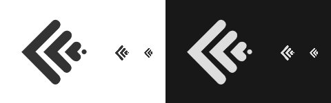

# CV Hub for Orca

Panel plugin for CV Hub hosted Git repositories on **stock [Orca](https://github.com/stablyai/orca)** (1.4.248 or newer, plugin host API 1). Sign in with CV Hub in your browser, browse repositories and pull requests, read a pull request's diffs inside the panel, check CI and review history, submit a review, and search code through CV Hub's Streamable HTTP MCP server.



The mark is adapted from CV Hub's branding and inherits Orca's text color. Design notes are in [`docs/design/`](docs/design/).

## What it adds to Orca

- A **CV Hub panel** in the right sidebar: repository picker, pull-request list, and a detail view with Overview (description, branches, head SHA, approvals), Files (per-file diffs), Checks and Reviews tabs.
- A **status bar item**: `CV Hub: sign in` when signed out, `CV Hub: <n> open PRs` for the repository of Orca's focused workspace when signed in (hidden when no CV Hub repository is detected). Pressing it signs in — or, when already signed in, refreshes the count.
- Three commands in the palette: **CV Hub: Sign in**, **CV Hub: Sign out** and **CV Hub: Refresh open pull requests**.
- A **CV Hub API origin** setting under Settings → Plugins → CV Hub.

Only stock Orca APIs are used: the manifest is format 2 (`trusted-worker`), the panel is an HTML page in Orca's isolated frame that talks to Orca only through the frozen `window.orca` API (worker `plugin.request`, pushed `auth.changed` / `context.changed` events, `shell.openExternal` from a button press, Orca's `--orca-*` theme variables), and the capabilities asked for are `storage:own`, `secrets:own`, `settings:own`, `workspace:read` and `notifications:show`.

## Build and install

Nothing is needed on the CV Hub side. The plugin signs in as `cv-git-cli`, the public device-flow client every CV Hub deployment ships for its own CLI tools (migration `0017_cv_git_oauth_client`), and it requests only `profile repo:read repo:write offline_access`, never the client's full set. Check a server with `GET <api-origin>/oauth/client-info/cv-git-cli`.

1. **From GitHub** (recommended): find **CV Hub** in Orca's plugin directory, or run

   ```sh
   orca plugin install lamtuanvu/cv-hub-orca-plugin
   ```

   Orca installs the newest `vX.Y.Z` release tag. Each tag points at a commit that holds only the built plugin (`orca-plugin.json`, `main.mjs`, `panel.html`); pin one with `@v0.6.0`, or follow the latest build of `main` with `@dist`. Don't install from `main`, which holds the sources. Orca installs the plugin as `lamtuanvu.cv-hub`: the publisher is derived from the repository owner, the way a Go module path is.

2. **From a local folder** (development): build it and load the folder. Orca runs no build, so the built `dist/` is the plugin:

   ```sh
   pnpm install --frozen-lockfile
   pnpm run package
   orca plugin dev watch dist/
   ```

   (`pnpm run package` = build, check and `dist/cv-hub-<version>.zip`; the zip is a release artifact of the same three files.)

3. Review what the plugin asks for and enable it. Update with `orca plugin update`.

**Upgrading from 0.5.x:** 0.6.0 runs on stock Orca and is a new plugin identity (`lamtuanvu.cv-hub`, derived from the repository owner, where 0.5.x installed as `controlvector.cv-hub`), so it installs fresh: review and enable it, then **sign in again**. The old install can be removed afterwards.

## Settings

The server is configured in **Settings → Plugins → CV Hub → CV Hub API origin** (default `https://api.hub.controlvector.io`). For a self-hosted or local server, enter its **API origin** — not the web app's address and not an `/api` path; locally, for example, `http://localhost:3001`. HTTPS is required except for loopback development servers. The panel shows which origin a sign-in will use; if a remembered server from an earlier install exists, it is kept while the setting still holds the default.

## Sign-in

Sign-in is the OAuth 2.0 device authorization grant (RFC 8628):

1. Choose **Sign in with CV Hub** (in the panel, the palette, or by pressing the status bar item). The worker requests a device code and shows it in the panel, and posts every phase change as an `auth.changed` event, so the panel never polls.
2. Press **Open CV Hub to approve**. That button press is what allows the panel to call Orca's `shell.openExternal` with the verification address — Orca asks before opening a web host the plugin has not opened before. If the browser doesn't open (declined, or a host without the method), the panel shows the address to open by hand.
3. Approve the code on CV Hub's `/device` page. The panel continues on its own, Orca shows a desktop notification, and the status bar starts counting open pull requests.

The worker validates the verification address before offering to open it: it must be CV Hub's `/device` page on the API origin, or on the web host beside an `api.` API host (API `https://api.hub.example.com` → page `https://hub.example.com/device`), which is how CV Hub is deployed; a loopback API accepts a loopback page on any port, for local development. An address that doesn't check out is shown for manual navigation only, never auto-opened.

Tokens live only in Orca's encrypted per-plugin secrets; profile metadata uses plugin storage. The device code, access token and refresh token never reach the panel: it sees the user code, the validated address and the account profile. Refreshes are serialized, the rotated refresh token is persisted before use, a rejected refresh ends the session without discarding drafts, and a 401 refreshes once and retries reads only — writes are never replayed. Sign-out deletes local credentials first, then revokes the tokens on the server and reports a failed revocation separately. The identity and MCP discovery endpoints are verified with the new token before sign-in is declared complete, and cross-origin MCP discovery is refused.

## Pull requests

The repository select defaults to the CV Hub repository detected for Orca's **focused workspace** (shown with a *Workspace* badge), else the repository last used on this account; focus changes are followed unless you pick another repository by hand. Detection reads the focused workspace's path via `workspace.list` and its git remotes directly (`git -C <path> remote -v`, no shell), maps them to owner/repository on your CV Hub, and verifies the repository exists before claiming it.

The pull-request list offers Open / Merged / Closed / All / My open PRs filters, one page at a time. The detail view's **Files** tab fetches the same `GET .../pulls/:n/diff` CV Hub's own web page renders — hunks relative to the merge base — and draws each file's unified patch in the panel's own diff viewer: hunk headers, old/new line numbers, add/delete coloring from the theme, and a unified/split toggle; one file is shown at a time. Patches are capped at 64 KiB per file so they fit the panel; CV Hub's own truncation and the panel's are both flagged, and such files offer an **Open in CV Hub** link instead. Binary files are listed but not shown.

Loading the Files tab is also what **pins the revision a review submits against**:

- Submitting a review always carries `expectedHeadSha`, and the worker re-reads the source branch's live head first: a push that lands before the submission is refused with *the PR changed*, and the panel asks you to inspect the new revision. Your draft is kept.
- A review can only be submitted after the Files tab has been opened (the panel says so), and approving your own pull request is labeled **Self approve**.
- If the connection drops while submitting, the outcome is unknown: the panel requires reloading the review history before allowing a retry, and only allows it once it confirms the review is absent — no write is ever silently repeated.
- A read-only sign-in can browse everything; publishing reviews needs `repo:write`.

**Open in CV Hub** buttons open the pull request's web page through `shell.openExternal`, using the web origin verified during sign-in.

## Code search

The **Code search** tab searches the selected repository through CV Hub's authenticated `/mcp` endpoint (`search_code`) and shows up to eight bounded snippets with Orca's code highlighter. Plugin installation does not register MCP with your coding agent; the endpoint is configured on CV Hub.

## Repository layout

- `src/worker/` — the trusted worker: OAuth device flow (`connection.ts`), REST client (`rest-client.ts`), MCP search (`mcp-client.ts`), repository detection (`workspace-repo.ts`), the panel diff (`pull-diff.ts`) and the request handlers, commands, events and status bar (`activate.ts`).
- `src/panel/` — the HTML panel: sign-in, repository and pull-request views, the review composer and code search, plus the in-panel diff viewer (`diff.ts`); `scripts/build.mjs` inlines its script, styles and images into the single `dist/panel.html`, the shape Orca's frame docs recommend so browser clients load it too.
- `src/shared/protocol.ts` — the panel ↔ worker contract, declared once with `PluginRequests` / `PluginPanelEvents`; both sides type-check against it.
- `src/shared/manifest.ts` — the manifest, generated into `orca-plugin.json` and validated against Orca's published schema in `src/shared/manifest.test.ts`.
- `types/orca/` — Orca's plugin typings, vendored so `pnpm type-check` needs no Orca CLI (MIT, like this plugin). `scripts/orca-schema.mjs` fetches Orca's manifest schema at a pinned commit for the manifest checks.

## Verification

```sh
pnpm install --frozen-lockfile
pnpm type-check
pnpm test
pnpm run package
```

`pnpm run package` also runs `scripts/check-package.mjs`: the built manifest is validated against Orca's format-2 schema, `dist/` is checked to hold exactly the files the manifest names, and the worker is activated against a stand-in host to prove it registers exactly the declared commands and the panel handlers. While developing, `orca plugin dev watch dist/` reloads on save, and `orca plugin validate dist/` runs the same manifest checks Orca runs on install.

See [VALIDATION.md](VALIDATION.md) for the checks that were run for this release and the environment limits.

## Security and license

Report vulnerabilities privately through GitHub's **Report a vulnerability** on this repository rather than in a public issue. Never paste OAuth tokens, device codes or private repository contents into issues.

MIT, see [LICENSE](LICENSE). The vendored typings in `types/orca/` are from [Orca](https://github.com/stablyai/orca), also MIT.
